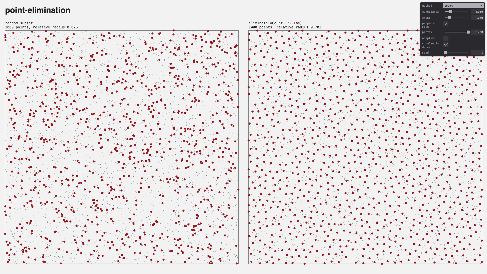

# point-elimination

[](https://www.npmjs.com/package/point-elimination)
[](https://www.npmjs.com/package/point-elimination)
[](https://bundlephobia.com/package/point-elimination)
[](https://github.com/dmnsgn/point-elimination/blob/main/package.json)
[](https://github.com/microsoft/TypeScript)
[](https://conventionalcommits.org)
[](https://github.com/prettier/prettier)
[](https://github.com/eslint/eslint)
[](https://github.com/dmnsgn/point-elimination/blob/main/LICENSE.md)

Eliminate 1D, 2D or 3D points: [weighted sample elimination](http://www.cemyuksel.com/research/sampleelimination/) to an exact count with progressive ordering, and greedy elimination by minimum distance, both with adaptive spacing.

`eliminateToCount` implements weighted sample elimination, progressive sampling and adaptive sampling from:

> Cem Yuksel. [Sample Elimination for Generating Poisson Disk Sample Sets](http://www.cemyuksel.com/research/sampleelimination/). _Computer Graphics Forum (Proceedings of EUROGRAPHICS 2015)_, 34(2), 25–32, 2015. [doi:10.1111/cgf.12538](https://doi.org/10.1111/cgf.12538)

Reference implementation: [cyCodeBase](http://www.cemyuksel.com/cyCodeBase/soln/poisson_disk_sampling.html)

[](https://paypal.me/dmnsgn)
[](https://commerce.coinbase.com/checkout/56cbdf28-e323-48d8-9c98-7019e72c97f3)
[](https://twitter.com/dmnsgn)
[](https://bsky.app/profile/dmnsgn.me)

[](https://dmnsgn.github.io/point-elimination/)

## Installation

```bash
npm install point-elimination
```

## Usage

See the [example](https://dmnsgn.github.io/point-elimination/) and its [source](examples/index.js).

```js
import {
  eliminateToCount,
  eliminateByDistance,
  packingRadius,
} from "point-elimination";

// 5000 random 2D points
const points = Float32Array.from({ length: 5000 * 2 }, Math.random);

// Poisson disk subset of exactly 1000 points
const indices = eliminateToCount(points, 1000, { dimension: 2 });
// => Uint32Array of kept point indices

// Progressive ordering: the first k indices are also well distributed, for any
// k. Slice the output to change the density without eliminating again.
const ordered = eliminateToCount(points, 1000, {
  dimension: 2,
  progressive: true,
});
const first100 = ordered.subarray(0, 100);

// The domain defaults to the bounding box (its volume for 3D points). Set it
// when points don't fill their bounding box, eg. the area of a mesh surface.
const surfaceIndices = eliminateToCount(meshPoints, 1000, {
  domainSize: meshArea,
  domainDimension: 2,
});

// Points at least 0.02 apart, earlier points first
const spaced = eliminateByDistance(points, 0.02, { dimension: 2 });

// Adaptive spacing: twice the distance where scale is 2
const scales = Float32Array.from({ length: 5000 }, (_, i) =>
  points[i * 2] < 0.5 ? 1 : 2,
);
const adaptive = eliminateByDistance(points, 0.02, { dimension: 2, scales });

// Poisson disk radius of 1000 points densely packed in a unit square: their
// minimum distance is twice that
const radius = packingRadius(1, 1000, 2);
```

## API

<!-- api-start -->

Auto-generated API content.

<!-- api-end -->

## License

MIT. See [license file](https://github.com/dmnsgn/point-elimination/blob/main/LICENSE.md).
